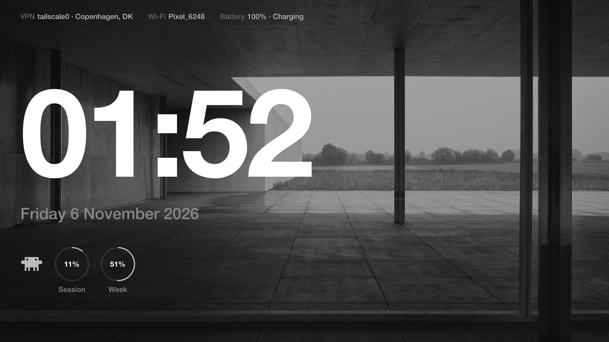

# SchwponacoOS

Hyprland on plain Arch, Swiss style: Helvetica, `#191919` bars, `#111111` background, `#BBBBBB` accents.



## What's here

Each top-level folder is a [GNU Stow](https://www.gnu.org/software/stow/) package that mirrors your home
folder. For example, `kitty/.config/kitty/kitty.conf` becomes `~/.config/kitty/kitty.conf`.

| Package | What it is |
| --- | --- |
| `hypr` | Hyprland (Lua config), the workspace 1 dashboard, volume popup, low-battery warnings |
| `waybar` | Top bar, with scratchpad icons and the VPN indicator |
| `quickshell` | Super+Tab workspace overview |
| `rofi` | App launcher; `!query` searches the web, `#name` opens one of your GitHub repos |
| `dunst` | Notifications |
| `kitty` | Terminal |
| `fish` | Shell |
| `nvim` | Neovim, with a LaTeX setup (`nvim/.config/nvim/lua/config/LATEX.md`) |
| `btop` | System monitor; the dashboard's process panel uses these settings |
| `superfile`, `cava`, `swayimg` | File manager, audio visualiser, image viewer |
| `scripts` | `~/.local/bin`: `cmdlib` (VPN/SSH menu), `screenshot`, `waybar-vpn`, `open-folder` |

Not stow packages:

| Folder | What it is |
| --- | --- |
| `packages/` | Package lists for pacman, the AUR, Flatpak and cargo |
| `grub/` | Helvetica GRUB theme and its install script |
| `zen/` | Zen browser: settings (`user.js`), extensions (`policies.json`) and their install script |

[SENSITIVE.md](SENSITIVE.md) lists what's deliberately kept out of the repo (licensed fonts, keys, photos).

## Rebuilding from scratch

### 1. Install Arch

Do a plain install with `pacstrap /mnt base linux linux-firmware`. Make a user with sudo rights, then
boot into it. Before step 3, enable `[multilib]` in `/etc/pacman.conf`; Steam needs it.

### 2. Get the dotfiles

```bash
sudo pacman -S --needed git stow
git clone https://github.com/Schwponaco-org/SchwponacoOS ~/SchwponacoOS
```

### 3. Install packages

The lists use one package per line, and `#` starts a comment.

```bash
cd ~/SchwponacoOS
sed 's/#.*//' packages/pacman.txt | xargs sudo pacman -S --needed
```

Install yay (an AUR helper) by hand once, then install the AUR list:

```bash
git clone https://aur.archlinux.org/yay-bin.git /tmp/yay-bin && (cd /tmp/yay-bin && makepkg -si)
sed 's/#.*//' packages/aur.txt | xargs yay -S --needed
```

Then Flatpak and cargo:

```bash
sudo pacman -S --needed flatpak
sed 's/#.*//' packages/flatpak.txt | xargs flatpak install -y flathub
rustup default stable
sed 's/#.*//' packages/cargo.txt | xargs cargo install --locked
```

### 4. Link the configs

```bash
cd ~/SchwponacoOS
stow btop cava dunst fish hypr kitty nvim quickshell rofi scripts superfile swayimg waybar
```

If stow reports a conflict, a real file already exists where a link should go, for example a default
config an app created on first run. Move that file away and run stow again. Stow never overwrites files.

To unlink a package, run `stow -D <package>`.

### 5. Add what the repo can't contain

[SENSITIVE.md](SENSITIVE.md) explains why each of these is missing:

- **Helvetica Neue**: put your licensed `.otf` files in `~/.local/share/fonts/Helvetica/Helvetica Neue/`.
- **Scratchpad icon font**: build it with `python3 ~/.config/waybar/build-scratchpad-icons.py`.
- **Dashboard and GRUB background**: put a photo at `~/Pictures/mies.jpg`.
- **SSH machines** for `cmdlib`: add them to `~/.ssh/config` as `Host` entries.
- **WireGuard configs**: put them in `/etc/wireguard/` (root only). A `# comment` on the first line becomes
  the config's label in `cmdlib`.

Then refresh the font cache with `fc-cache -f`.

### 6. Services, shell, GRUB

```bash
sudo systemctl enable --now NetworkManager bluetooth power-profiles-daemon firewalld
chsh -s /usr/bin/fish
xdg-mime default superfile.desktop inode/directory   # folders open in superfile
sudo usermod -aG input $USER   # the Super+Tab overview reads the Super key; log out and in after
~/SchwponacoOS/grub/install-theme.sh
~/SchwponacoOS/zen/install.sh   # start Zen once first, so it has a profile
```

`cmdlib` starts and stops `tailscaled` itself, so it doesn't need to be enabled.

### 7. Start Hyprland and sign in

Log in on a TTY and run `start-hyprland`, or use the `swag` alias in fish. Claude Desktop, the dashboard,
waybar, the overview and the battery warnings all start automatically.

The dashboard's Claude usage rings read terminal Claude Code's login. Install it, then run `claude` once to
sign in. Run it again now and then to keep the login fresh.

```bash
curl -fsSL https://claude.ai/install.sh | bash
```

## Keys

| Keys | Action |
| --- | --- |
| Super+Return | Terminal |
| Super+D | Launcher (`!query` searches the web, `#name` opens a GitHub repo) |
| Super+E | File manager |
| Super+Tab | Workspace overview: hold Super, tap Tab, let go to switch |
| Super+C / Super+Shift+C | Claude scratchpad / send Claude back to it |
| Super+S / Super+Shift+S | Scratchpad / move a window to it |
| Super+Z | Close gaps between workspaces |
| Super+H/J/K/L | Move focus |
| Super+F | Fullscreen |
| Super+U | Lock |
| Super+Shift+Q | Close window |
| Super+Shift+M | Log out |
| Shift+Ctrl+S | Screenshot a region |
| Space (on the dashboard) | System panel with btop |

## Scripts

- `cmdlib`: a menu for WireGuard, Tailscale and SSH. Its entries come from `/etc/wireguard` and
  `~/.ssh/config`, so the script itself holds no addresses or names.
- `waybar-vpn`: shows the active VPN in waybar, and where traffic exits (looked up at ipinfo.io).
- `screenshot`: drag out a region; the image is saved to `~/Pictures/Screenshots` and copied to the
  clipboard.
- `open-folder`: opens folders in superfile; it's the default app for folders. It also turns KDE Connect's
  "Browse this device" link into the phone's mounted storage.

## Zen

`zen/user.js` holds the browser settings: always private browsing, no history, everything cleared on exit,
tracker and fingerprinting protection, HTTPS-only, encrypted DNS. It's re-applied on every start, so change
settings there rather than in Zen's settings page. `zen/policies.json` installs uBlock Origin and Tridactyl
(beta) and turns off telemetry and studies; check `about:policies` after setup.
